<div align="center">


# Vigil

**Know which new vulnerabilities affect your Mac, your repositories and your servers,
and fix them with one confirmed click.**

[](https://github.com/GeorgiosDelkos/vigil/actions/workflows/test.yml) [](https://github.com/GeorgiosDelkos/vigil/actions/workflows/check.yml) [](https://github.com/GeorgiosDelkos/vigil/actions/workflows/app.yml)    [](LICENSE)

</div>

<p align="center">
  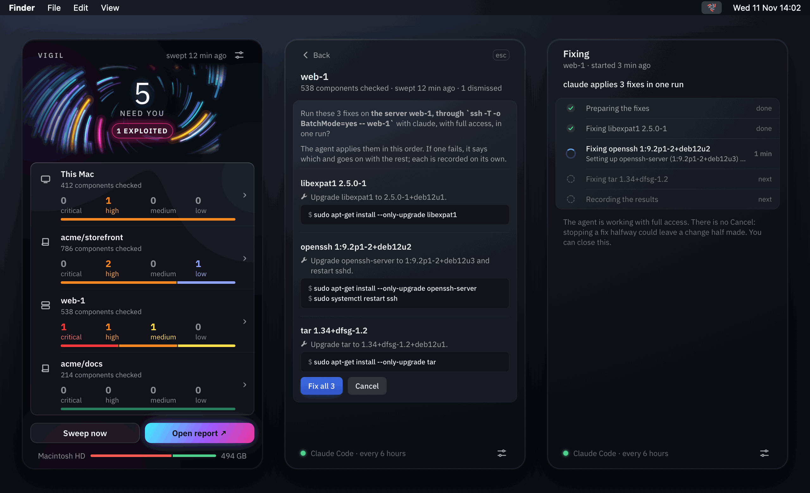
</p>

New CVEs land every day, in every stack you run. Vigil is a macOS menu-bar app that pulls the
newest advisories, works out which of them could touch the software you actually have
installed, and asks a coding agent of your choice (Claude Code, Grok, Codex, Gemini or
opencode) to judge whether each one really affects you. What does shows up in the menu bar
with its severity, an explanation and an exact fix. You approve a fix, and the agent applies it.

It sweeps three kinds of target in one pass:

| Target | What Vigil reads |
|---|---|
| **This Mac** | macOS, Homebrew formulae and casks, Rust, Node.js and Python toolchains, global npm, cargo, uv and pipx packages, and the lockfiles (`Cargo.lock`, `package-lock.json`, `npm-shrinkwrap.json`, `uv.lock`, `poetry.lock`) in the project folders you choose |
| **GitHub repositories** | The dependency graph, Dependabot, code scanning and secret scanning alerts, Actions workflows, and security settings such as branch protection |
| **Servers** | OS packages (Debian, Ubuntu and Alpine are matched to advisories; RPM packages are listed for the agent), the kernel, listening sockets, Docker containers and images, and lockfiles, read over SSH by a fixed read-only script |

## Contents

- [Highlights](#highlights)
- [Screenshots](#screenshots)
- [How a sweep works](#how-a-sweep-works)
- [Safety model](#safety-model)
- [Getting started](#getting-started)
- [Configuration](#configuration)
- [Command line](#command-line)
- [Advisory sources](#advisory-sources)
- [Supported agents](#supported-agents)
- [Project layout](#project-layout)
- [Development](#development)
- [Status](#status)
- [License](#license)

## Highlights

- **Only what applies to you.** The app narrows the advisory feeds to the packages and
  products in your inventory, then drops CVEs whose CPE ranges cannot cover the versions you
  have. On one Mac that took the agent's input from 10,304 advisories to 267.
- **An agent's judgement, with the evidence.** Each finding says what is affected, where it
  was found, why it matters and how to fix it, with the exact commands.
- **Exploited first.** Advisories in CISA's Known Exploited Vulnerabilities catalog are
  flagged and always kept, and the popover ranks them above everything else.
- **Fixes you approve.** Nothing changes until you confirm a fix. A dependency fix in a
  repository is made on a branch and opened as a pull request.
- **A fix is not done until a sweep says so.** A fix the agent reports stays open and counted,
  marked "Fix reported" or "Pull request open". It moves to the Fixed list only once a later
  sweep no longer finds the problem.
- **Quiet until it matters.** The menu-bar icon shows the worst open severity at a glance,
  and a notification arrives only for new critical or high findings and issues.
- **Files you own.** Configuration, reports, dismissals and fix history are plain TOML, JSON
  and Markdown in your Library folder. The menu-bar app and the CLI share them.

## Screenshots

All screenshots use example data: well-known CVEs with their real affected versions, on
example targets.

<table>
  <tr>
    <td width="33%" align="center">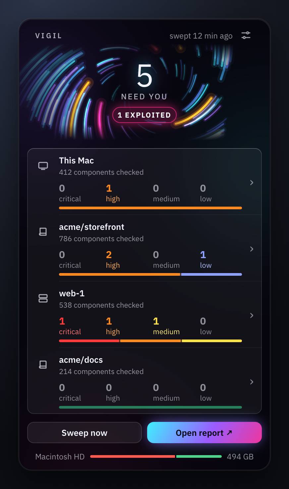<br><sub><b>Needs you.</b> Critical, high and exploited findings, worst first.</sub></td>
    <td width="33%" align="center">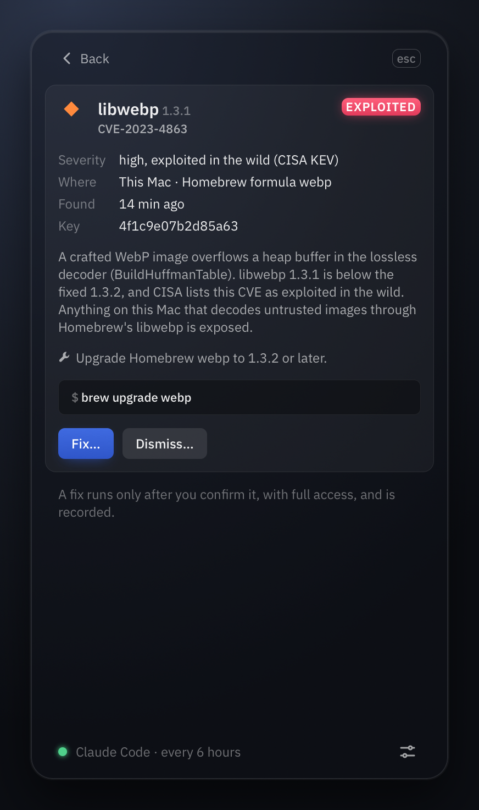<br><sub><b>Details.</b> The agent's explanation and the exact fix.</sub></td>
    <td width="33%" align="center">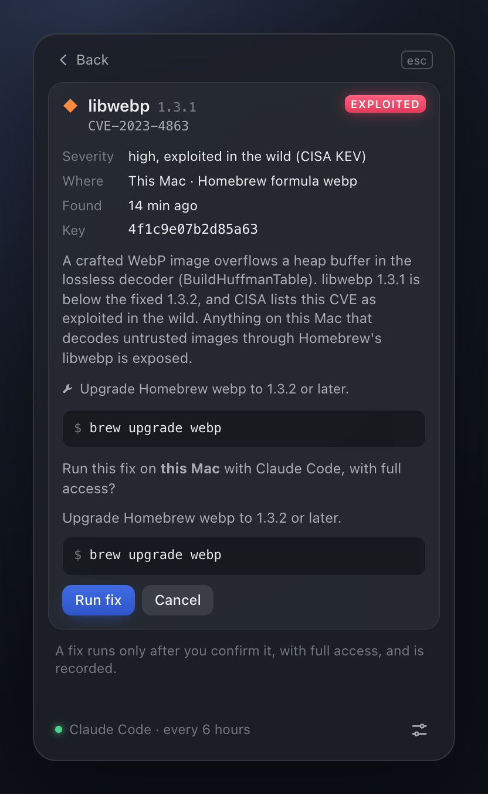<br><sub><b>Confirm.</b> Where the fix runs, with which agent, and what it runs.</sub></td>
  </tr>
  <tr>
    <td align="center">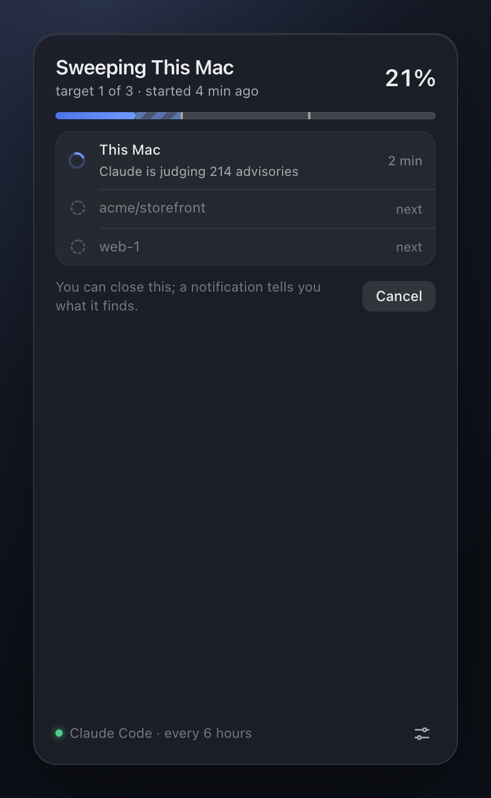<br><sub><b>Sweeping.</b> Progress across targets, cancellable at any time.</sub></td>
    <td align="center">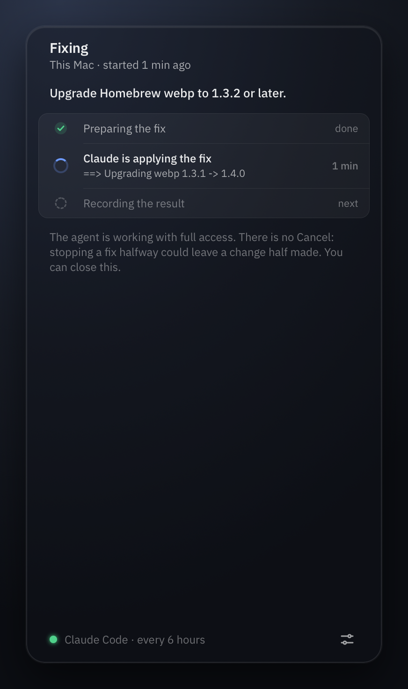<br><sub><b>Fixing.</b> Each step, with the agent's latest output.</sub></td>
    <td align="center">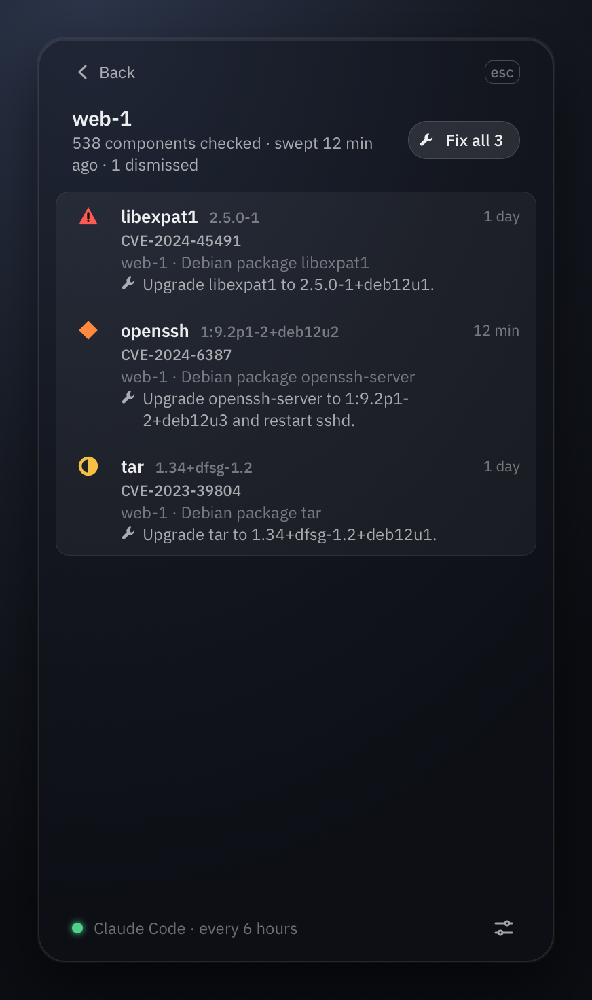<br><sub><b>Targets.</b> What each sweep checked and what it found.</sub></td>
  </tr>
  <tr>
    <td align="center">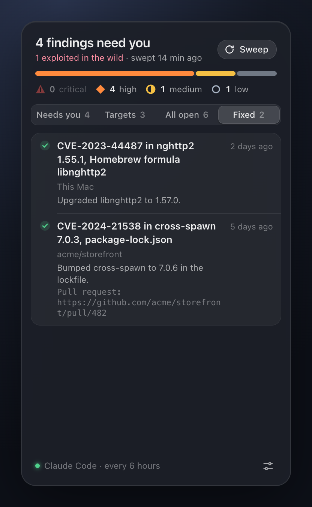<br><sub><b>Fixed.</b> Fixes a later sweep confirmed, for 30 days.</sub></td>
    <td align="center">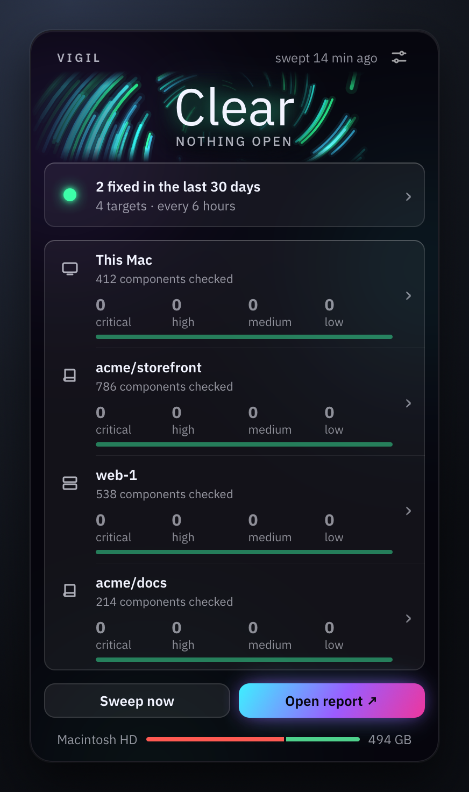<br><sub><b>All clear.</b> Every target swept, nothing open.</sub></td>
    <td align="center">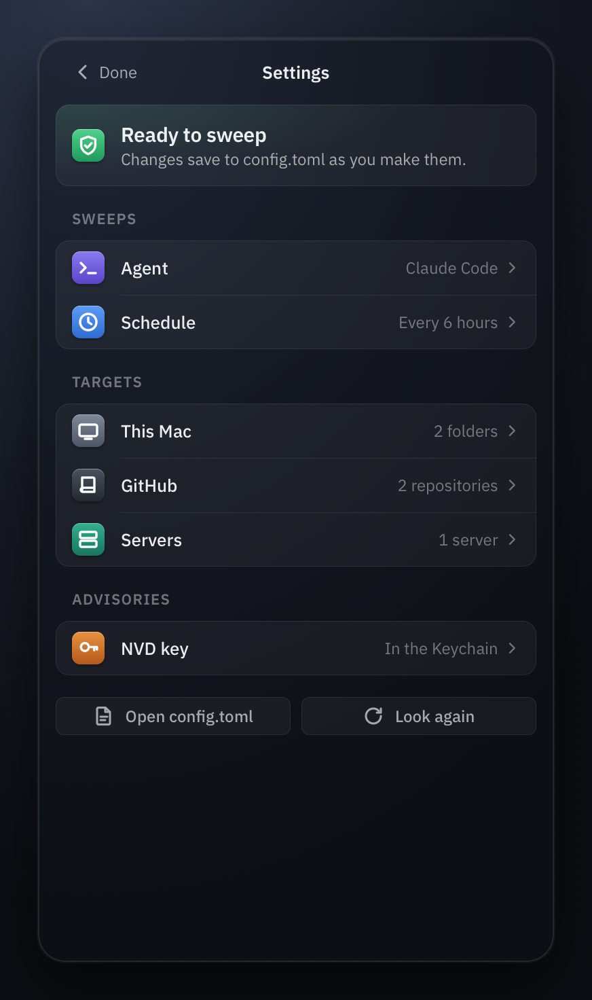<br><sub><b>Settings.</b> Agent, schedule, targets and NVD key.</sub></td>
  </tr>
</table>

The menu-bar icon is Vigil's mark, a spiral of dots, and its colour carries the state:

<p align="center">
  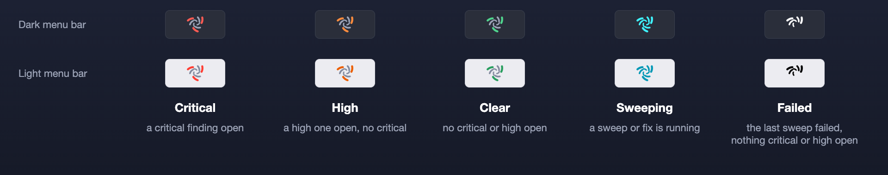
</p>

A left click opens the popover; a right click offers Quit Vigil.

## How a sweep works

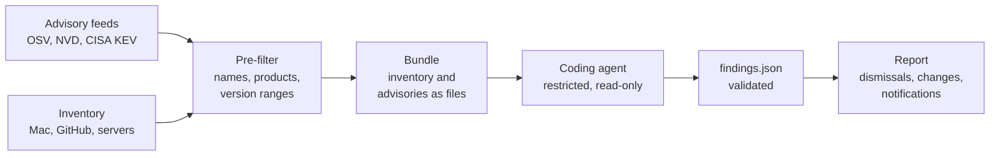

Targets are swept one after another, each in its own folder under `sweeps/<time>/`:

1. **Feeds.** OSV records and NVD CVEs are cached locally: OSV records are fetched again only
   when they change, and NVD is asked only for what changed since the last fetch. The CISA KEV
   catalog (about 2 MB) is downloaded on every sweep.
2. **Inventory.** The app collects what is installed. For a repository it reads the GitHub
   API with your `gh` login; for a server it runs a fixed script over SSH.
3. **Bundle.** The inventory, the advisories that could apply, the findings schema and the
   prompt are written as files for the agent to read.
4. **Verdict.** The agent reads the bundle and writes `findings.json`. The app validates it
   strictly and gives the agent one retry with the error if it is malformed.
5. **Report.** Findings get stable keys, dismissals are applied, the result is compared with
   the target's last sweep, and a JSON and Markdown report is written, the Markdown one with
   the agent's evidence for each finding. New critical and high findings raise a
   notification.

## Safety model

Advisory text, repository files and server output are all untrusted input, and a coding agent
acts on what it reads. Vigil is built around that.

| | Sweeps | Fixes |
|---|---|---|
| **Agent permissions** | Restricted through each agent's own controls (see [Supported agents](#supported-agents)): reading is allowed, writing is limited to the bundle folder, and shell commands to a few listing commands or none | Full access, and only after you confirm that specific fix |
| **What the agent is given** | The bundle the app collected. The app, not the agent, reads GitHub and your servers | The confirmed fix, not the sweep's evidence, which came from untrusted text |
| **Where it is told to act** | Its bundle folder | This Mac; for a repository, a clone, a branch and a pull request; for a server, one SSH host |

The fix rules in the last row are instructions in the fix prompt, which the agent runs with
full access. The app checks what it can afterwards: the result must name a pull request in the
same repository, and every run is recorded in the fix history.

More of the design:

- **Checked before you are asked.** Before the confirmation, the app checks that the finding
  is still in the target's newest report, is not dismissed, and still passes the sweep's text
  checks, and that the target is still configured.
- **Read-only server collection.** The server script never uses `sudo`. SSH runs in batch
  mode with strict host key checking, and with agent and port forwarding off.
- **Stopping cleanly.** Cancelling a sweep or quitting the app stops the agent and every
  process it started, and removes the unfinished target's folder. A fix has no Cancel, since
  stopping halfway could leave a change half made; quitting during one stops it and records
  its outcome as unknown.
- **Secrets stay put.** The NVD API key is stored only in the macOS Keychain.
- **Escaped output.** Agent text is escaped in reports, so it cannot forge Markdown or send
  terminal escape sequences.

## Getting started

Vigil is built from source for now. A signed and notarized DMG is planned.

### Requirements

- macOS
- [Rust](https://rustup.rs). The pinned toolchain (`rust-toolchain.toml`) is installed
  automatically on first build.
- [Node.js](https://nodejs.org) (the current LTS) and [pnpm](https://pnpm.io) 10, to build the
  interface
- At least one supported coding agent, installed and logged in
- [GitHub CLI](https://cli.github.com), logged in with `gh auth login`, to sweep repositories
- SSH access without a password prompt, to sweep servers. Host keys must already be in
  `~/.ssh/known_hosts`.

### Build and run the menu-bar app

```sh
git clone https://github.com/GeorgiosDelkos/vigil.git
cd vigil
pnpm --dir app/ui install --frozen-lockfile
pnpm --dir app/ui build
cargo build --release -p vigil-app --features custom-protocol
./target/release/vigil-app
```

Vigil appears in the menu bar, with no Dock icon. Open the popover, pick your agent in
Settings, add project folders, repositories and servers (this Mac is always swept), and press
**Sweep**. The gear menu turns on launch at login, which also keeps a schedule running.

### Install the command-line tool

```sh
cargo install --path crates/cli
vigil init      # creates the data folder and a default config.toml
vigil config    # validates it and shows what a sweep would cover
vigil sweep
```

### Raise the NVD rate limit (optional)

Without a key NVD allows 5 requests per 30 seconds; with one it allows 50. Request a key from
[NVD](https://nvd.nist.gov/developers/request-an-api-key), then add it in Settings, or store
it in the Keychain yourself:

```sh
security add-generic-password -s io.github.georgiosdelkos.vigil -a nvd-api-key -w <key>
```

## Configuration

Everything lives in `~/Library/Application Support/io.github.georgiosdelkos.vigil/`. The app's
settings and `config.toml` edit the same file:

```toml
agent = "claude"                 # claude, grok, codex, gemini or opencode

[models]
claude = "opus"                  # optional, per agent; the agent's default otherwise

[schedule]
every_hours = 6                  # run by the menu-bar app; leave unset to sweep on demand

[history]
since = "all"                    # or a date such as "2025-01-31"

[mac]
project_dirs = ["~/code"]        # searched for lockfiles; project code is never run

[github]
repos = ["acme/storefront"]

[[servers]]
name = "web-1"
ssh = "web-1"                    # an alias from ~/.ssh/config, or host, user, port, identity_file
dirs = ["/srv/app"]
```

The data folder also holds:

| Path | Contents |
|---|---|
| `prompts/` | The sweep and fix prompts, editable |
| `feeds/` | The OSV and NVD caches; safe to delete |
| `sweeps/<time>/<target>/` | One folder per target (`mac`, `github-<owner>--<name>`, `server-<name>`) |
| `sweeps/<time>/<target>/report.{json,md}` | The target's report |
| `sweeps/<time>/<target>/bundle/` | What the agent read, and the `findings.json` it wrote |
| `sweeps/<time>/<target>/agent-<n>.log` | The agent's output, one log per attempt |
| `fixes/<time>-<key>/` | Each fix's prompt, the agent's log and its result |
| `state/dismissals.json` | Dismissed findings and issues, with reasons |
| `state/fixes.jsonl` | Every fix run, one line each |
| `report.html` | The HTML report from `vigil report` or the app, replaced each time |

## Command line

The `vigil` CLI uses the same core and the same files as the app.

| Command | What it does |
|---|---|
| `vigil init` | Create the data folder and a default `config.toml` |
| `vigil config` | Validate `config.toml` and print what a sweep would cover |
| `vigil inventory` | List what is installed on this Mac, one JSON object per line |
| `vigil advisories --package npm:lodash --product openssl` | Fetch advisories for packages and NVD products |
| `vigil sweep [--target mac \| github:<owner>/<name> \| server:<name>]` | Sweep every target, or one |
| `vigil findings [--json]` | Each target's open findings, with their keys |
| `vigil report [--open]` | Write `report.html`, a dark page with every finding in full, print its path, and open it in the browser |
| `vigil dismiss <key> --reason <text>` | Hide a finding or issue, for a reason; a finding returns if its advisory changes |
| `vigil undismiss <key>` | Show a dismissed finding or issue again |
| `vigil fix <key> [--yes]` | Show a finding's fix, ask to confirm, and have the agent apply it |

Every command takes `--data-dir <dir>` to use another data folder. Ctrl-C cancels a sweep
cleanly (exit code 130); a second Ctrl-C exits at once.

## Advisory sources

| Source | Used for |
|---|---|
| [OSV.dev](https://osv.dev) | Language and OS package advisories, including the GitHub Advisory Database and malicious-package reports |
| [NVD](https://nvd.nist.gov) | CVEs for macOS, Homebrew software and toolchains, matched by CPE product and version range |
| [CISA KEV](https://www.cisa.gov/known-exploited-vulnerabilities-catalog) | Marking CVEs that are exploited in the wild |

OSV is queried by package name, and the full records are cached locally. It sees version
numbers only for a server's OS packages, where the distribution's own version rules decide.

## Supported agents

| Agent | CLI | Sweeps | Fixes |
|---|---|---|---|
| [Claude Code](https://docs.anthropic.com/en/docs/claude-code) | `claude` | Writes only `findings.json`; shell limited to `brew info`, `brew list`, `npm ls`, `npm view` | Full access after confirmation |
| [Grok](https://x.ai) | `grok` | Writes only `findings.json`; no shell | Full access after confirmation |
| [Codex](https://github.com/openai/codex) | `codex` | Workspace-write sandbox: may write anywhere in the bundle folder | Full access after confirmation |
| [Gemini CLI](https://github.com/google-gemini/gemini-cli) | `gemini` | Auto-edit: may edit anywhere in the bundle folder | Full access after confirmation |
| [opencode](https://opencode.ai) | `opencode` | Denied by default; reads, `findings.json` and the same listing commands as Claude Code | Full access after confirmation, except what your own opencode config denies |

Agents are found through your login shell's `PATH` (`$SHELL -lc`), so an agent installed with
npm or Homebrew usually starts as it does in a terminal. With zsh that reads `.zprofile`, not
`.zshrc`: an agent whose `PATH` entry is only in `.zshrc`, as nvm often sets it, is not found
until the entry is also in `.zprofile`. The model each agent uses is set in Settings or in
`[models]`.

## Project layout

```
crates/core/      vigil-core   feeds, inventory, agents, sweep, findings, lifecycle, fixes
crates/cli/       vigil        the command-line tool
app/src-tauri/    vigil-app    the menu-bar app (Tauri 2)
app/ui/                        the popover interface (SolidJS and TypeScript)
docs/spec.md                   the design, with the reasoning behind each decision
```

The logic lives in Rust. The interface only lays out what the core works out, so the app and
the CLI always agree.

## Development

```sh
cargo fmt --check
cargo clippy --all-targets -- -D warnings
cargo test

pnpm --dir app/ui check          # oxlint, oxfmt and tsc
pnpm --dir app/ui test           # vitest

pnpm --dir app/ui build          # the app's tests embed the built interface
cargo test -p vigil-app --features custom-protocol
```

For a live-reloading app, run `cargo tauri dev` in `app/src-tauri` (needs `cargo install
tauri-cli`).

CI runs the same checks (tests with `cargo nextest`, on all features), the interface's checks
and tests, and `cargo mutants` over each ready pull request's changes; `cargo deny` runs when
dependencies change and daily. Tests use a fake agent on `PATH` to exercise sweeps, retries
and failures without a real one.
See [`docs/spec.md`](docs/spec.md) for the full design.

## Status

Vigil is under active development. It is complete enough for daily use on one Mac:
sweeps, findings, dismissals, confirmed fixes and fix history all work across the three
target types. Next on the list:

- A signed and notarized DMG, which needs an Apple Developer account
- Lockfiles not read yet: `pnpm-lock.yaml`, `yarn.lock`, `bun.lock`, `Pipfile.lock` and
  `go.sum`
- Node and Python versions managed by nvm, fnm, volta, asdf or pyenv, beyond the one on `PATH`

## License

Vigil is released under the [MIT License](LICENSE). It is provided as is, without warranty
of any kind: review a fix before you confirm it, since the agent then runs it with full
access.
